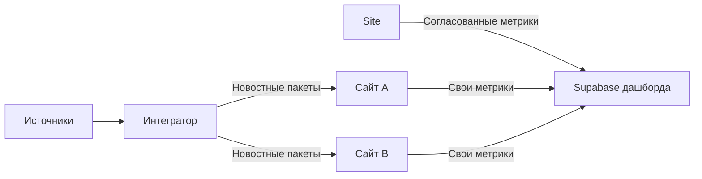
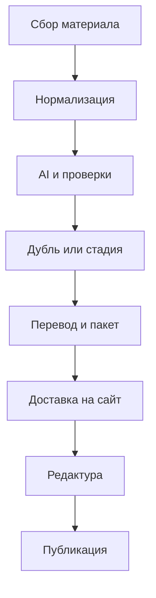

# Системная архитектура

**Статус:** Draft 0.1  
**Дата:** 2026-07-17  
**Зависимости:** `00_INDEX.md`, `00_GLOSSARY_AND_CONVENTIONS.md`, `01_PRODUCT_REQUIREMENTS.md`

## 1. Цель

Документ определяет логические границы, компоненты, ответственность, потоки данных и правила взаимодействия универсальной AI-платформы развлекательных новостей. Он является основой для модели данных, API-контрактов, структуры репозитория и архитектуры развёртывания.

## 2. Архитектурные принципы

1. **Независимые шаблоны.** Интегратор и сайт являются отдельными продуктами, устанавливаются независимо и имеют собственные панели и БД.
2. **Настройка по месту.** Темы, языки, регионы, источники, дизайн и правила задаются конфигурацией установки.
3. **API вместо общей БД.** Обмен выполняется только через версионированные контракты.
4. **Владелец данных один.** Каждая операционная сущность имеет единственный авторитетный компонент.
5. **Асинхронность и идемпотентность.** Сбор, AI, перевод, доставка, публикация и аналитика выполняются устойчивыми фоновыми задачами.
6. **Человек контролирует риск.** На первом этапе публикации, спорные объединения, парсеры и AI-медиа подтверждаются человеком.
7. **Заменяемые провайдеры.** AI, аналитика трафика, объектное хранилище, платежи и каналы подключаются адаптерами.
8. **Безопасное расширение.** Дополнительный сайт, интегратор, язык или канал не требует изменения ядра.
9. **Наблюдаемость локальна.** Каждая установка самостоятельно контролирует свою работу; в дашборд передаётся аналитическая копия согласованных метрик.
10. **Полная поставка.** Архитектура не является временным MVP и включает эксплуатацию, обновление, восстановление и расширение.

## 3. Системный контекст



Дашборд не вызывает API интегратора или сайта для построения показателей и не управляет их операционными сущностями.

## 4. Единица развёртывания и идентичность

Каждая установка имеет:

- стабильный UUID `instance_id`;
- `instance_type`: `integrator` или `site`;
- отображаемое имя;
- версию приложения и контрактов;
- собственные секреты;
- собственную PostgreSQL;
- собственное объектное хранилище или namespace;
- собственный журнал аудита;
- отдельную административную панель.

Центральный реестр установок не обязателен. Подключение создаётся двусторонней настройкой и уникальными credentials. Компрометация одного подключения не должна открывать другие сайты.

## 5. Логические контейнеры интегратора

### 5.1. Integrator Admin

Интерфейс для источников, тем, языков, AI, парсеров, сайтов-получателей, очередей, расходов, мониторинга и дашборда. Не содержит бизнес-логику доступа к данным в браузере; вызывает Integrator API.

### 5.2. Integrator API

FastAPI-приложение:

- авторизация и RBAC;
- CRUD конфигурации;
- управление источниками и подключениями сайтов;
- просмотр материалов, событий, пакетов и доставок;
- запуск контролируемых операций;
- health/readiness;
- OpenAPI.

### 5.3. Scheduler

Создаёт задания сбора, проверки источников, периодических переводов, очистки, суточных агрегатов и повторной доставки. Scheduler не выполняет тяжёлую работу внутри своего процесса.

### 5.4. Source Workers

Адаптеры RSS, API, YouTube, HTML и поискового обнаружения. Нормализуют результат в `source_material`. Соблюдают правила источника, rate limits и robots.txt.

### 5.5. Browser Workers

Playwright workers запускаются отдельно от API. Имеют ограниченные ресурсы и сетевые политики. Selenium подключается отдельным адаптером при необходимости.

### 5.6. Parser Lab / Sandbox

Изолированная среда создания, статической проверки, тестирования и пробного запуска AI-сгенерированных адаптеров. Не имеет доступа к production-секретам и БД на запись. Активация создаёт подписанную/хешированную версию адаптера после одобрения.

### 5.7. Processing Workers

Выполняют нормализацию, релевантность, классификацию, извлечение сущностей и фактов, importance score и построение canonical card.

### 5.8. Deduplication and Event Service

Находит технические и смысловые дубли, поддерживает события и стадии, рассчитывает кандидатов и объяснение совпадения. Пограничные решения попадают в review queue.

### 5.9. AI Gateway

Единая внутренняя точка AI-операций:

- реестр провайдеров и моделей;
- маршрутизация;
- строгие схемы;
- retries/fallback;
- budget и rate limits;
- prompt registry;
- usage/cost accounting;
- composite confidence;
- redaction секретов и лишних данных.

### 5.10. Translation Workers

Создают и кэшируют версии `материал + язык + версия`, применяют терминологический словарь и фиксируют QA. Переводы выполняются только интегратором.

### 5.11. Media Service

Проверяет политику использования, скачивает разрешённые оригиналы, вычисляет checksum, хранит metadata/provenance и готовит безопасную доставку. Подключаемая генерация медиа является отдельным адаптерным pipeline.

### 5.12. Package Builder

Собирает неизменяемую версию `canonical_news_package`, валидирует обязательные поля и сохраняет сериализуемый payload до начала доставки.

### 5.13. Delivery Workers

Для каждого подключения применяют фильтры тем, языков и регионов, подписывают запрос, доставляют пакет в Site Ingestion API, сохраняют ответы, выполняют backoff, DLQ и ручной retry.

### 5.14. Локальная наблюдаемость интегратора

Сохраняет и показывает метрики источников, очередей, AI-операций, расходов и доставок только внутри установки. Интегратор не подключается к Supabase дашборда.

### 5.15. Integrator Storage

- PostgreSQL — основная БД;
- Redis — очередь, locks и краткоживущий cache;
- S3/MinIO — HTML snapshots, документы и медиа;
- локальные/централизованные логи и метрики.

## 6. Логические контейнеры сайта

### 6.1. Public Web

Рекомендуется Next.js с SSR/SSG/ISR по типу страницы. Отвечает за публичные страницы, языки, SEO, Schema.org и пользовательские взаимодействия. Не имеет прямого доступа к секретам интеграций или платежей.

### 6.2. Site Admin

Отдельный интерфейс редакторов, SEO, интеграций, рекламы, платежей и аналитики. Может использовать общую Next.js-кодовую основу с Public Web, но имеет отдельный route boundary, авторизацию и сборку по принятому ADR.

### 6.3. Site API

FastAPI-приложение сайта:

- Site Ingestion API для интеграторов;
- редакционные операции и версии;
- публикация и планирование;
- публичный read-only API;
- RBAC и audit;
- платежи, реклама и webhook endpoints;
- управление дашбордом и каналами.

### 6.4. Ingestion Service

Проверяет identity интегратора, подпись, schema version, idempotency и размер. Сохраняет payload как неизменяемый `incoming_news_package`, возвращает однозначный результат и ставит задачу сопоставления.

### 6.5. Editorial Service

Создаёт `site_article`, версии и редакционные задания. Показывает diff обновлённого пакета, поддерживает частичное принятие, конфликты, исправления и аудит.

### 6.6. Publication Service

Управляет approval, embargo, schedule, атомарной публикацией, обновлением, снятием и архивом. Обновляет поисковые представления и создаёт события для downstream-задач.

### 6.7. Site Media Service

Импортирует только разрешённые файлы, сохраняет provenance и права, создаёт производные размеры и реагирует на `media_rights_changed`.

### 6.8. Search and Read Model

Обеспечивает быстрый публичный поиск, фильтры, связанные материалы и страницы сущностей. На первом этапе может использовать PostgreSQL full-text/pgvector; OpenSearch остаётся возможностью масштабирования.

### 6.9. Distribution Workers

Создают адаптации опубликованной версии для Telegram, соцсетей, CMS, рассылок и других каналов. Ошибка канала не меняет статус публикации на сайте.

### 6.10. Payment Gateway and Billing

Gateway-адаптеры изолируют внешних провайдеров. Billing владеет customer, product/plan, subscription, invoice, payment, refund и ledger/audit. Webhook обрабатывается идемпотентно и проверяется криптографически.

### 6.11. Advertising Service

Управляет inventory/placements, advertiser, campaign, creative, schedule, targeting, disclosure и агрегированной статистикой. Для прямой продажи вызывает Billing через внутренний интерфейс, но не реализует платежи самостоятельно.

### 6.12. Traffic Analytics Importer

Периодически получает агрегаты из выбранной аналитической системы или серверных логов. Отдельные pageview не отправляются напрямую в Supabase.

### 6.13. Site Analytics Exporter

Отправляет site events, почасовые и суточные агрегаты из outbox в Supabase независимо от редакционного и публичного трафика.

### 6.14. Site Storage

- PostgreSQL — основная БД сайта;
- Redis — queue/cache/locks;
- S3/MinIO — локальные копии медиа и рекламные creatives;
- поисковый индекс — встроенный или внешний по ADR.

## 7. Владение данными и репликация

| Данные | Владелец | Допустимые копии |
|---|---|---|
| Источник, parser config/version | Интегратор | Локальные backup и read models интегратора |
| Исходный материал, событие, стадия | Интегратор | Ссылки/выбранные поля в пакете |
| Канонический пакет | Интегратор | Неизменяемый входящий пакет сайта |
| Входящий пакет | Сайт | Backup сайта |
| Site article/version/publication | Сайт | Read models, cache, каналы |
| Media original | Интегратор или внешний правообладатель | Сайт только при разрешении |
| Customer/payment/advertising | Сайт | Обезличенные агрегаты дашборда |
| Операционные метрики интегратора | Интегратор | Только локальный мониторинг интегратора |
| Согласованные метрики сайта | Сайт | Аналитическая копия Supabase |

Supabase не является источником восстановления операционных данных.

## 8. Основные потоки

### 8.1. Источник до публикации



Каждый переход сохраняет статус, correlation id, результат и ошибку. Повтор шага не создаёт второго эффекта.

### 8.2. Обновление новости

1. Интегратор получает новый материал.
2. Event Service определяет дубль либо новую стадию.
3. Изменение фактов/источников/перевода создаёт новую версию пакета.
4. Delivery Worker доставляет её с новым idempotency key.
5. Сайт сохраняет новый входящий пакет рядом с предыдущим.
6. Редактор получает diff и выбирает поля для применения.
7. Сайт создаёт новую article version.
8. После approval публикация атомарно переключается на новую версию.

### 8.3. Аналитика

Операционная транзакция сайта одновременно создаёт запись в локальном outbox. Site Analytics Exporter асинхронно отправляет её в Supabase. При успехе запись помечается доставленной; при временной ошибке применяется backoff; после лимита — DLQ и alert. Суточный агрегат не заменяет исходный срочный event.

### 8.4. Отзыв прав на медиа

Интегратор фиксирует изменение прав и отправляет обновлённый пакет/уведомление связанным сайтам. Сайт находит публикации и запрещает новое использование; редактор выбирает замену, embed, скрытие или удаление. Все действия аудируются.

## 9. Контракты и события

Минимальные границы API:

```text
Integrator Admin API          /api/v1/...
Site Ingestion API            /api/v1/incoming-news-packages
Site Editorial API            /api/v1/editorial/...
Site Public API               /api/v1/public/...
Payment webhooks              /api/v1/webhooks/payments/{provider}
Dashboard PostgREST           /rest/v1/{approved_table}
```

Основные внутренние события:

```text
source.scan_completed
source.failed
source.recovered
material.normalized
event.matched
event.stage_created
package.created
package.delivery_failed
package.delivered
incoming_package.received
article.approved
publication.published
publication.corrected
media.rights_changed
payment.succeeded
subscription.changed
advertising.campaign_changed
```

Имена и payload фиксируются в `14_PUBLIC_AND_INTERNAL_API.md`; произвольные события в обход контракта запрещены.

## 10. Надёжность и ошибки

- Внешние вызовы имеют timeout, retry policy и circuit breaker там, где это обосновано.
- Permanent validation/authorization errors не повторяются автоматически.
- Queue message подтверждается только после успешной транзакции или безопасного checkpoint.
- Outbox предотвращает потерю события между БД и очередью/HTTP.
- DLQ доступна в панели с причиной и ручным retry.
- Большой payload и медиа передаются отдельно или временной подписанной ссылкой.
- Несовместимая major schema version отклоняется с машиночитаемой ошибкой.
- Clock skew не используется для определения дубля; опора на идентификаторы и версии.

## 11. Безопасность

- TLS обязателен за пределами localhost.
- Межсистемные credentials имеют минимальный scope и ротацию.
- Запрос доставки подписывается; защита от replay учитывает timestamp/nonce/idempotency.
- Секреты хранятся server-side и маскируются в логах.
- RBAC проверяется API; критические действия требуют re-auth/MFA по принятому security design.
- Parser Sandbox изолирован от production runtime.
- Внешний HTML, JSON, медиа и AI-output считаются недоверенными.
- Webhook платежей проверяется по подписи провайдера и обрабатывается идемпотентно.
- Личные и платёжные данные не передаются в дашборд.

## 12. Нефункциональные требования

- Горизонтальное масштабирование stateless API и workers.
- Отсутствие локального незарегистрированного состояния контейнеров.
- Correlation ID проходит через сбор, AI, доставку и приём сайта.
- Версионирование конфигурации, промптов, parser adapters и contracts.
- Structured logs, metrics и traces для критических потоков.
- Graceful shutdown workers без потери подтверждённых задач.
- Backward compatibility контрактов в пределах major-версии.
- SLO, RPO/RTO и capacity limits назначаются после получения ожидаемых объёмов.

## 13. Технологический статус

### Approved

- Python-first;
- Python 3.12+ стабильной версии;
- FastAPI, Pydantic, SQLAlchemy, Alembic;
- PostgreSQL каждой установки;
- Playwright как основной browser engine;
- Docker, OpenAPI и автоматические тесты.

### Recommended до ADR

- Next.js/TypeScript для Public Web и панелей;
- Redis + Celery;
- pgvector;
- S3 API и MinIO для self-hosted;
- Caddy;
- OpenTelemetry, Prometheus, Grafana и Loki.

## 14. Тесты

- contract tests Integrator → Site для каждой поддерживаемой minor-версии;
- idempotency и повторная доставка;
- временная недоступность сайта и Supabase;
- DLQ и ручной retry;
- parser sandbox escape tests;
- обновление пакета без перезаписи статьи;
- несколько сайтов на интегратор и несколько интеграторов на сайт;
- разрешённое/запрещённое копирование медиа и отзыв прав;
- RBAC negative tests;
- платежный webhook duplicate/replay;
- сквозной путь метрик сайта в дашборд и проверка отсутствия подключения интегратора к Supabase.

## 15. Критерии приёмки

1. Компоненты и их зависимости можно однозначно сопоставить будущему дереву репозитория.
2. Ни один поток не требует общей БД сайта и интегратора.
3. Для каждой основной сущности назначен владелец.
4. Сбой любого внешнего сервиса не приводит к потере принятого операционного события.
5. Обновление пакета не изменяет опубликованный текст без решения сайта.
6. Только сайт отправляет согласованные данные в дашборд; интегратор не подключается к Supabase.
7. Сгенерированный parser code не выполняется в доверенном API/worker-контейнере.
8. Архитектура поддерживает оба направления кардинальности: один интегратор → много сайтов; много интеграторов → один сайт.

## 16. Open Decisions

1. Очередь: Celery/Redis, Dramatiq или другой вариант.
2. Размещение Site Admin: отдельное приложение или защищённая часть общего Next.js.
3. Поиск: PostgreSQL/pgvector по умолчанию и критерий перехода на OpenSearch.
4. Механизм межсистемной подписи: HMAC либо asymmetric signing/mTLS.
5. Object storage default: встроенный MinIO или внешний S3.
6. Reverse proxy: Caddy, Traefik или Nginx.
7. Ожидаемые объёмы, SLO, RPO/RTO и retention.
8. Конкретные AI, аналитические и платёжные провайдеры.
