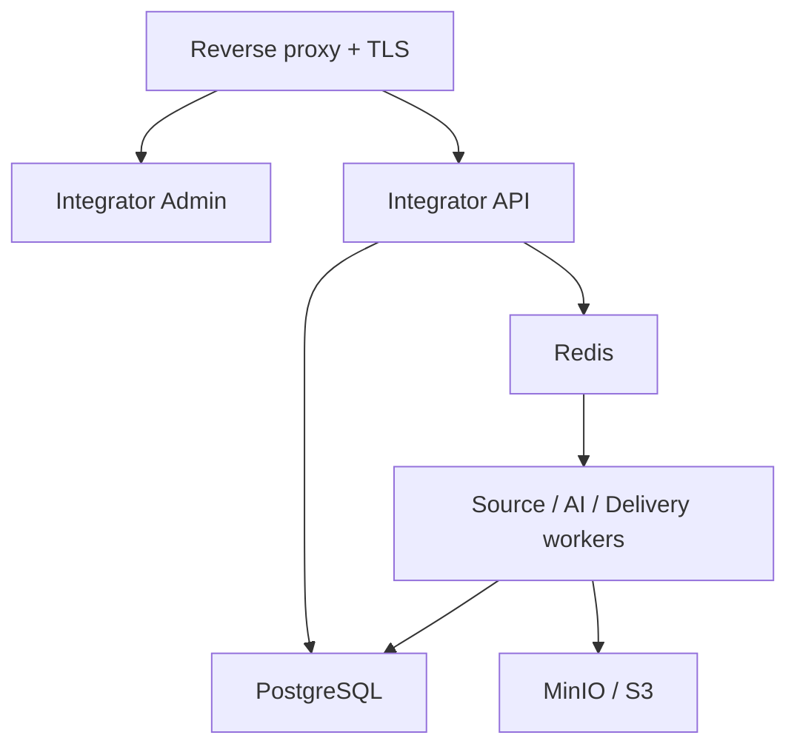

# Архитектура развёртывания

**Статус:** Draft 0.1  
**Дата:** 2026-07-17  
**Зависимости:** `01_PRODUCT_REQUIREMENTS.md`, `02_SYSTEM_ARCHITECTURE.md`

## 1. Цель и область ответственности

Документ определяет, как отдельно устанавливаются и эксплуатируются шаблон интегратора и шаблон сайта. Он охватывает контейнеры, сети, хранилища, домены, TLS, масштабирование, установку, обновление, rollback, backup и первоначальную настройку.

Конкретные команды и процедуры будут детализированы в `20_DEPLOYMENT_INSTALLATION_AND_UPDATES.md`, `24_CONFIGURATION_REFERENCE.md` и `25_OPERATIONS_RUNBOOK.md`.

## 2. Утверждённая модель поставки

Каждый интегратор и каждый сайт поставляется как самостоятельно разворачиваемый контейнеризированный продукт. Основной формат:

```text
исходный репозиторий
+ Dockerfile каждого сервиса
+ production docker-compose.yml
+ development compose
+ Windows/Linux scripts
+ web setup wizard
```

Интегратор и сайт:

- не обязаны находиться на одном сервере;
- не используют общую основную БД;
- обновляются независимо;
- имеют разные домены/поддомены и секреты;
- могут использовать совместимую внешнюю инфраструктуру, но с отдельными БД, credentials и namespace.

Монолитный EXE запрещён. Возможный будущий EXE — только launcher/installer для проверки Docker, настройки Compose и открытия панели.

## 3. Режим A — один сервер

### 3.1. Интегратор



Production Compose интегратора содержит минимум:

- `reverse-proxy`;
- `integrator-api`;
- `integrator-admin`;
- `scheduler`;
- `source-worker`;
- `browser-worker`;
- `processing-worker`;
- `ai-worker`;
- `translation-worker`;
- `delivery-worker`;
- `parser-sandbox-runner`;
- `postgres`;
- `redis`;
- `minio` при локальном объектном хранилище;
- monitoring/logging profile.

Workers могут использовать общий образ с разными командами запуска, но остаются отдельными Compose services и масштабируются независимо.

### 3.2. Сайт

Production Compose сайта содержит минимум:

- `reverse-proxy`;
- `site-api`;
- `public-web`;
- `site-admin` либо отдельный защищённый deployment общего Next.js по ADR;
- `scheduler`;
- `editorial-worker`;
- `publication-worker`;
- `distribution-worker`;
- `analytics-worker`;
- `billing-worker`;
- `advertising-worker`;
- `postgres`;
- `redis`;
- `minio` при локальном хранении;
- monitoring/logging profile.

### 3.3. Ресурсная изоляция

Для каждого сервиса задаются CPU/memory limits, health checks, restart policy и log rotation. Browser и parser sandbox получают отдельные жёсткие ограничения. PostgreSQL и объектное хранилище размещаются на постоянных volumes, не зависящих от жизненного цикла контейнера.

## 4. Режим B — масштабируемое развёртывание

В распределённом режиме без изменения кода можно разнести:

- reverse proxy/load balancer;
- stateless API replicas;
- public web replicas;
- admin frontend;
- отдельные worker pools по очередям;
- browser workers;
- parser sandbox nodes;
- managed PostgreSQL;
- managed Redis;
- external S3/CDN;
- monitoring stack.

Правила:

- API и frontend не хранят пользовательские файлы на локальном диске;
- несколько scheduler instances используют leader election/lock;
- worker concurrency задаётся отдельно для каждого типа задач;
- browser workload не разделяет узел с основной БД в крупной установке;
- миграции запускаются одной контролируемой job;
- масштабирование сайта не требует доступа к БД интегратора.

Kubernetes может быть добавлен позднее как инфраструктурный профиль, но не является обязательным для первой полной поставки. Docker Compose остаётся поддерживаемым способом эксплуатации.

## 5. Сети и входящие точки

### Интегратор

Публично доступны только:

- HTTPS Integrator Admin/API;
- health endpoint с ограниченным содержимым;
- при необходимости callback endpoints официальных провайдеров.

PostgreSQL, Redis, MinIO console и worker ports не публикуются наружу.

### Сайт

Публично доступны:

- HTTPS Public Web;
- public read-only API;
- Site Ingestion API с обязательной аутентификацией;
- payment webhooks;
- административная панель с аутентификацией;
- health endpoint.

Внутренняя сеть данных отделяется от public edge network. Межсерверная связь выполняется только по TLS.

## 6. Домены и TLS

Рекомендуемое решение до ADR — Caddy с автоматическим TLS. Допустимые альтернативы: Traefik и Nginx + ACME client.

Установка сайта поддерживает:

- основной домен;
- `www` alias;
- административный поддомен или защищённый путь;
- redirect HTTP→HTTPS;
- canonical host;
- безопасное обновление сертификатов;
- staging domain без индексации.

Установка интегратора обычно использует непубличный административный домен, VPN/IP allowlist или дополнительный access proxy.

## 7. Основные хранилища

### PostgreSQL

Каждая установка использует отдельную логическую БД и отдельного пользователя. Допускается один managed PostgreSQL cluster, если сохранены отдельные databases, credentials, backup/restore и ограничения доступа.

### Redis

Используется для очередей, locks и cache. Redis не является авторитетным хранилищем бизнес-данных. Потеря Redis не должна уничтожать принятые пакеты или публикации.

### S3/MinIO

Интерфейс хранения — S3-compatible. Self-hosted profile включает MinIO; cloud profile использует внешний S3. Интегратор и сайт используют отдельные buckets/prefixes и credentials.

### Supabase

Supabase принадлежит внешнему дашборду. Только сайт имеет исходящее подключение для согласованных метрик. Supabase не включается в backup основной БД сайта и не используется для восстановления сайта.

## 8. Конфигурация и секреты

- `.env.example` содержит только имена и безопасные примеры.
- Production secrets не коммитятся и не показываются в frontend.
- Web wizard сохраняет секреты server-side.
- В Docker Compose secrets могут храниться в защищённых файлах; масштабируемый профиль поддерживает внешний secret manager.
- API keys имеют отдельные scopes и могут ротироваться без полной переустановки.
- Export backup по умолчанию не содержит открытых секретов; при включении секретов архив обязательно шифруется.

## 9. Установка пользователем

Обязательный сценарий:

1. Пользователь устанавливает Docker.
2. Распаковывает комплект или клонирует репозиторий.
3. Запускает `install.bat` либо `install.sh`.
4. Скрипт проверяет Docker/Compose, порты, свободное место и создаёт локальную конфигурацию.
5. Запускаются инфраструктура, миграции и setup service.
6. Пользователь открывает указанный URL.
7. Web wizard создаёт первого администратора и `instance_id`.
8. Выполняется настройка домена, времени, языков, хранилища и резервного копирования.
9. Интегратор дополнительно настраивает AI и источники; сайт — интеграторы, дашборд, платежи и рекламу.
10. Wizard выполняет self-test и закрывает bootstrap endpoint.

Повторный запуск install не создаёт второго администратора и не перезаписывает настройки.

## 10. Скрипты управления

Для Windows и Linux обязательны эквивалентные операции:

```text
install
start
stop
restart
update
backup
restore
status
logs
```

Скрипты должны быть неинтерактивными там, где переданы параметры, возвращать корректный exit code и не удалять данные при обычном stop/restart/update.

## 11. Health checks

Каждый сервис имеет:

- `liveness` — процесс способен обслуживать runtime;
- `readiness` — обязательные зависимости доступны;
- `startup` для медленно стартующих компонентов.

Общий status показывает API, frontend, DB, Redis, storage, queues, scheduler и миграции. Health endpoint не раскрывает секреты, SQL errors или внутренние адреса.

## 12. Обновление и rollback

Update выполняется так:

1. Проверка текущей и целевой версии.
2. Проверка совместимости contract/schema.
3. Автоматический backup.
4. Загрузка подписанных/проверенных images.
5. Запуск preflight checks.
6. Миграции одной job.
7. Поочерёдное обновление сервисов.
8. Health и smoke tests.
9. Фиксация результата и версии.

При ошибке приложение возвращается к совместимым предыдущим images. Если миграция необратима, rollback данных выполняется только документированной процедурой восстановления backup. Необратимые миграции требуют явного предупреждения и отдельного плана.

Пользовательские темы, источники, подключения, шаблоны и секреты не перезаписываются обновлением.

## 13. Backup и restore

Backup включает:

- PostgreSQL dump/base backup по выбранному профилю;
- manifest версий;
- конфигурацию без открытых секретов либо зашифрованную конфигурацию;
- объектное хранилище или список объектов/версию bucket backup;
- пользовательские шаблоны и адаптеры;
- контрольные суммы.

Restore проверяет тип установки, версию, checksum, доступное место и совместимость. Восстановление сначала выполняется в staging namespace/volume, после чего проходит smoke test.

RPO/RTO и retention остаются Open Decision до получения нагрузки и требований заказчика; процедура восстановления обязана тестироваться автоматически независимо от значений.

## 14. Мониторинг и журналирование

Каждая установка имеет локальные structured logs, metrics и alerts. Рекомендуемый стек до ADR: OpenTelemetry, Prometheus, Grafana и Loki. Интегратор показывает источники, очереди, AI, стоимость и доставки только в своей панели/мониторинге. Сайт дополнительно отправляет согласованные аналитические данные в Supabase.

## 15. Безопасность развёртывания

- контейнеры запускаются non-root, где это возможно;
- read-only root filesystem для stateless services;
- capabilities удаляются по умолчанию;
- images фиксируются digest/version и сканируются;
- parser sandbox не монтирует Docker socket;
- DB/Redis/MinIO не публикуются в интернет;
- CORS и trusted hosts задаются явно;
- admin endpoints защищены rate limiting и MFA-ready authentication;
- backup шифруется и проверяется;
- demo credentials запрещены в production.

## 16. Ошибки и пограничные случаи

- занятый порт — install сообщает точный конфликт и предлагает безопасную перенастройку;
- нет Docker — понятная инструкция без частичной установки;
- недостаточно диска — запуск миграции/backup не начинается;
- DNS ещё не обновлён — локальная настройка доступна, TLS ожидает домен;
- внешний S3 недоступен — новые медиа ставятся в retry, API продолжает обслуживать существующие данные;
- Redis потерян — очередь восстанавливается по выбранному механизму, авторитетные данные остаются в PostgreSQL;
- Supabase недоступен — сайт накапливает outbox в пределах retention и не блокирует публикацию;
- несовместимый пакет интегратора — сайт возвращает версионированную ошибку без изменения данных.

## 17. Тесты

- чистая установка Windows/Linux;
- повторный install;
- start/stop/restart/status/logs;
- установка интегратора и сайта на разных hosts;
- TLS и смена домена;
- backup/restore с медиа;
- update и rollback;
- потеря Redis/S3/Supabase;
- горизонтальный запуск двух API/workers;
- отсутствие внешней публикации DB/Redis;
- parser sandbox isolation;
- сохранение пользовательской конфигурации после update.

## 18. Критерии приёмки

1. Пользователь без навыков разработки разворачивает продукт через install script и wizard.
2. Интегратор и сайт устанавливаются и удалённо связываются независимо.
3. Односерверный профиль не требует ручного запуска отдельных контейнеров.
4. Масштабируемый профиль использует те же приложения и контракты.
5. Backup успешно восстанавливается в чистое окружение.
6. Ошибка Supabase не влияет на публикацию сайта; интегратор не подключается к Supabase.
7. Update сохраняет настройки и имеет проверяемый rollback.
8. Внешнее сканирование не обнаруживает открытые DB, Redis или MinIO management ports.

## 19. Open Decisions

1. Reverse proxy: Caddy (рекомендация), Traefik или Nginx.
2. Очередь: Celery/Redis (рекомендация до ADR), Dramatiq или иной вариант.
3. MinIO включён по умолчанию или выбирается wizard только для self-hosted profile.
4. Конкретные SLO, RPO, RTO и сроки хранения backup/outbox/logs.
5. Минимальные и рекомендуемые CPU/RAM/disk после назначения ожидаемой нагрузки.
6. Нужен ли официальный Kubernetes/Helm profile в полной поставке либо только документированный путь масштабирования.

